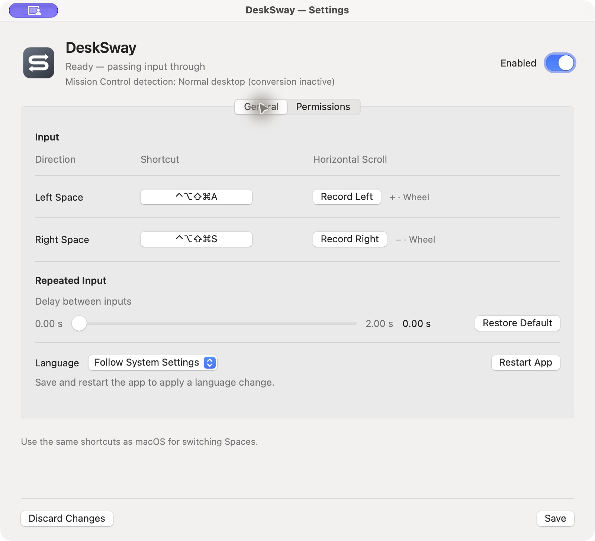
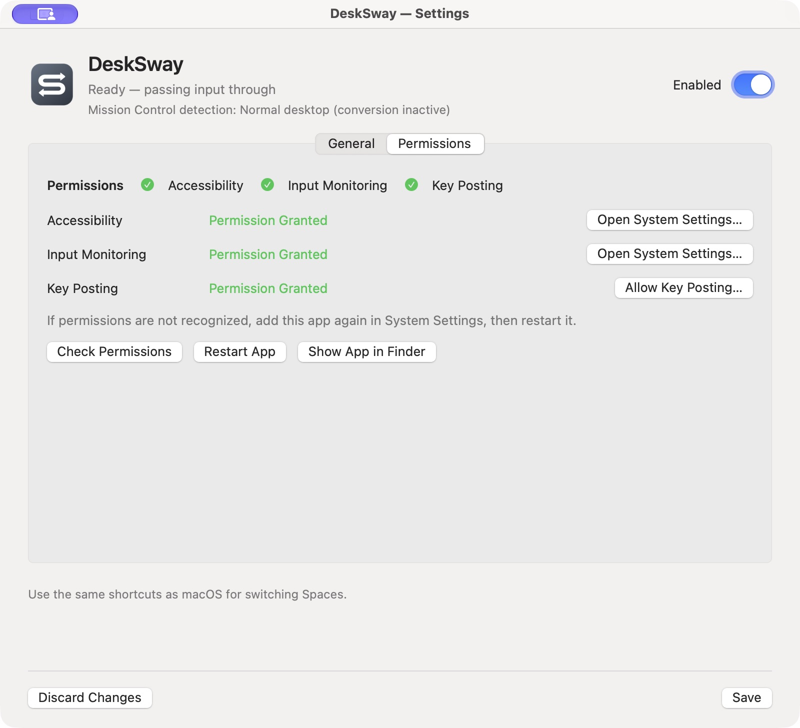

# DeskSway

A small native macOS menu-bar app that turns horizontal wheel-style scrolling into Space shortcuts while Mission Control is detected. Swift, AppKit and public ApplicationServices APIs; no external packages, network service, analytics, updater or automatic login item.

English and Japanese settings, directly recorded shortcuts and scroll directions, and a configurable repeat delay are included. On 2026-11-05, the maintainer reported that all real-device acceptance checks had passed in their environment. This does not establish compatibility with every Mac, mouse or macOS version. The [stage 1 report](docs/phase1-validation.ja.md) and [stage 2 report](docs/stage2-validation.ja.md) retain the earlier development evidence and its limits.

## Screenshots





Screenshots show one saved configuration; record the shortcuts and mouse directions that match your own setup.

## Build and run

The current build was checked with Xcode 27.2 / Swift 6.4.2 on macOS 27.2, arm64. The package's deployment floor is macOS 14; that is **not** a compatibility claim for older OS versions or Intel. Detection relies on undocumented system UI structure and is currently only validated on macOS 27.2 with one display.

```sh
swift test
./scripts/build-app.sh
open .build/DeskSway.app
```

The script creates `.build/DeskSway.app` with a local ad-hoc signature, without personal signing information. It is not Developer ID signed or notarized. Rebuilding may require regranting app permissions. Keep the app at a stable location when testing permissions; if you move it to Applications, quit the previous copy first. Only run one copy at a time.

Building from source does not require a paid Apple Developer Program membership. A downloaded prebuilt app without Developer ID signing and notarization may be blocked by macOS. If you trust its source, follow [Apple's instructions for opening an app from an unidentified developer](https://support.apple.com/en-us/102445). Accessibility, Input Monitoring and key-posting permissions are still required separately.

## First use

1. Launch DeskSway to add it to the menu bar. Open the app again, or choose **Settings… / 設定…** from its menu, to show settings on the current Space. The header shows whether DeskSway is enabled and what Mission Control state it detects. **Command-W** closes settings and **Command-Q** quits while the app is focused. Unsaved changes require confirmation before closing or quitting.
2. Open **Permissions / 権限**. Check the separate Accessibility, Input Monitoring and Key Posting statuses. Use **Open System Settings… / システム設定を開く…** for Accessibility/Input Monitoring and **Allow Key Posting… / キー送信を許可…** for the dedicated event-posting request. **Check Permissions / 権限を再確認**, **Restart App / アプリを再起動**, and **Show App in Finder / アプリの場所を表示** are on this tab. Only a user-initiated permission action requests access. Screen Recording is not used.
3. Open **General / 一般**. Click the shortcut button for each direction, then physically press and release the shortcut configured for macOS “Move left/right a space.” This records the shortcut without changing system settings. Modifier-only input is ignored; unsupported/bare keys and duplicate left/right shortcuts are rejected.
4. Click **Record Left / 左を記録** and **Record Right / 右を記録**, operating the actual mouse horizontally in each desired direction. Keep the pointer over settings. The received sign and wheel/gesture format are shown beside each button. Both directions must be opposite signs of the same format. Vertical-dominant and momentum input do not register. Conversion continues while settings is open and pauses only during explicit input recording.
5. Under **Repeated Input / 連続入力**, adjust **Delay between inputs / 次の入力までの待ち時間** from 0.00–2.00 seconds in 0.05-second steps (default 0.60). Zero accepts every eligible event without a waiting interval. **Restore Default / 標準に戻す** restores 0.60 seconds. Choose **Follow System Settings / システム設定に従う**, **日本語**, or **English** under **Language / 言語**; language changes require saving and restarting.
6. Click **Save / 保存** (Command-S) to apply shortcuts, scroll mapping and repeat delay together while leaving settings open. Unsaved edits do not affect conversion. **Discard Changes / 変更を破棄** closes settings without saving the draft. Quit BetterTouchTool before enabling DeskSway, then use the header switch or **Resume / 実行** in the menu. Pause or quit DeskSway before restoring BetterTouchTool.

**Permission troubleshooting:** Key posting uses `CGRequestPostEventAccess`; requesting Accessibility alone is not a substitute for that request. If Accessibility and Input Monitoring are recognized but key posting is not, use **キー送信を許可…** and follow macOS’s instructions, then recheck/restart if needed. An enabled switch in System Settings does not guarantee that the current binary is authorized. During this trial, macOS explicitly logged a code-requirement mismatch between a previous DeskSway grant and the rebuilt ad-hoc binary. If the app still reports missing permission, remove the old DeskSway entry from the affected privacy list, add the current app shown by **アプリの場所を表示**, grant access, then restart. Do this yourself in System Settings; DeskSway never changes TCC records or bypasses authorization. Ad-hoc rebuilds can require repeating this step. A stable certificate-backed signing setup is not included in this local trial.

The run/pause choice and shortcuts are saved locally in standard Preferences under `local.DeskSway`. Settings are never written to the repository. Opening settings does not stop conversion; unsaved changes require confirmation before closing. On later launches the prior run preference is restored, but conversion still waits for all readiness conditions. Login at startup is not enabled; you can add the app through macOS Login Items yourself if wanted.

## Input protection and limits

- Runtime conversion taps scroll events only. Explicit shortcut recording temporarily taps key down/up in the foreground settings window; it stores one key code and modifier set, never text. Input waiting times out after 15 seconds and focus loss cancels new recording. Cancellation drains only already-swallowed keys until release, including their repeats, before removing the tap; unrelated keys pass through and are not recorded. Restart/quit waits for these held keys to be released. Clicks and middle-button actions are untouched. Generated events are one configured key-down/up pair.
- Conversion requires running state, valid settings, Accessibility, listen/post access, an enabled tap, and a Mission Control observation no more than 500 ms old. All other states pass input through, including App Exposé, unknown, stale detection, pause and missing permissions.
- AX reads run on a separate serial queue with a 200 ms polling target, a 150 ms timeout on **each** AX element, depth 4 and 200-node limits per host. Observation age starts before the scan, not at completion. Sleep/session and relevant process changes invalidate pending results. Multiple AX calls can exceed the poll interval. There is an unavoidable observation window after MC closes; 500 ms is a freshness bound, not a measured detection delay.
- Eligible horizontal input can repeat within the same wheel burst or recorded gesture after the configured waiting time (0.00–2.00 seconds, default 0.60). The interval is measured from the last generated shortcut, so intervening input does not extend it. During the wait only matched horizontal components are suppressed. Each movement needs a new actual input event: there is no repeat timer, queued movement or catch-up after silence. Zero input and momentum never cause another movement.
- Detection/permission loss still interrupts the stream. A wheel stream needs 250 ms without horizontal input before it can resume; a recorded gesture needs a new begin event. This safety reset is separate from the normal repeat interval.
- Vertical-dominant input passes intact. Mixed horizontal-dominant input retains all vertical and third-axis fields while only horizontal fields are cleared. Failures to prepare replacement/key events leave the original event intact. The public posting API provides no acknowledgement that macOS acted on a shortcut.
- **Public CGEvents do not authenticate a physical device.** Defaults accept phase-less wheel-style events, including continuous ones from some mouse smoothers. Recording a phase-bearing input explicitly enables that gesture format. The same format from a trackpad cannot be distinguished from the recorded mouse; momentum always passes without generating a shortcut. A smoother that drops gesture/momentum metadata cannot be reliably distinguished from a new wheel burst. The maintainer reports successful real-device acceptance in their setup; other mouse/smoother combinations are not guaranteed. Do not treat this as an absolute hardware-mouse filter.
- A disabled tap clears detection and is retried with permissions checked, at most every two seconds. Missing permissions can require an app restart. Permission behavior and multi-display compatibility can differ between environments.

## Development and removal

`Sources/DeskSwayCore` owns input policy, shortcut validation, CGEvent preparation and the shared AX reader. `Sources/DeskSway` owns the unified settings, short-lived recorder, main-thread menu, runtime event tap and lifecycle; AX IPC runs separately. The [read-only probe](probes/mission-control/README.md) uses the same reader but does not link the input adapter or install a tap. Tests construct events but never post them.

To remove the app, quit it and remove the built `.app`. Remove any permission or login-item entries you added through System Settings. Preferences may be retained; deleting the `local.DeskSway` preferences domain separately resets local settings. No background helper, launch agent or service is installed.

Source is maintained in [Tasuku24/DeskSway](https://github.com/Tasuku24/DeskSway). A public license has not yet been selected. Local ad-hoc builds are not Developer ID-signed or notarized distributions.
